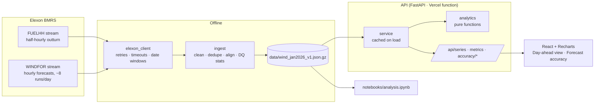

# Wind Forecast Desk

**Wind Forecast Desk** is a pilot web app for a GB utility's day-ahead power trading team. On D-1, traders decide how much power to buy on top of expected wind generation. The app shows the **latest national wind forecast that was available at the decision cutoff** (D-1 09:00 UK by default) next to what the wind actually produced, and measures how wrong that forecast tends to be: MAE, bias, tail errors, and how the error grows with lead time. It then turns the measured error into **P10/P50/P90 reliability bands** and a **"firm wind" (P10) figure**, so the desk can size extra procurement against the wind it can actually count on. The pilot covers decisions made in January 2026 and uses only Elexon BMRS data.

**Live demo:** _<add Vercel URL after deploy>_

## Key findings (January 2026, D-1 09:00 forecast)

All figures are for the 744 delivery hours from 2 January to 1 February 2026, using the latest WINDFOR run published by D-1 09:00 UK. They are reproduced in the notebook and served by `/api/metrics`.

| Metric | Value |
|---|---|
| MAE | **2,039 MW** (18% of mean actual output of 11,284 MW) |
| RMSE | 2,505 MW |
| Bias (forecast − actual) | **+1,748 MW**. The forecast was too high in **85%** of hours |
| Absolute error P50 / P90 / P99 | 1,671 / **4,098** / 6,261 MW |
| Error vs lead time | MAE rises from 1,680 MW at 0h to 2,413 MW at 47h ahead |
| Hardest hour | 05:00 UK (MAE 2,430 MW) |
| Firm wind (P10) | **9,045 MW** on average, against a mean forecast of 13,031 MW |

- The forecast is consistently optimistic. Treat the raw number as an upper case when sizing purchases.
- Moving the cutoff from 09:00 to 10:00 picks up the 09:30 run, but only improves MAE by 26 MW. A 12:00 cutoff would save 138 MW, but that is after gate closure.
- The P10 bands hold up out-of-sample. Fitted on 2–16 January only, 91% of 17 January – 1 February hours came in at or above P10 (the target is 90%).

Full analysis: [notebooks/analysis.ipynb](notebooks/analysis.ipynb), which includes data-quality tables, a worked selection example, cutoff sensitivity and the band back-test.

## Repository layout

| Path | What it is |
|---|---|
| `backend/app/config.py` | Every constant and env-driven setting (window, cutoff, horizons, quantiles, HTTP) |
| `backend/app/elexon_client.py` | HTTP client for the BMRS stream endpoints: timeouts, retries with backoff, date-window pagination |
| `backend/app/ingest.py` | Cleaning, de-duplication, gap and DST checks, half-hourly→hourly alignment, versioned snapshot I/O |
| `backend/app/analytics.py` | Pure functions: horizon, decision and horizon selection, metrics, breakdowns, bands |
| `backend/app/service.py` | Loads the snapshot once and answers API-shaped queries |
| `backend/app/schemas.py`, `main.py` | Pydantic response models and FastAPI routes with input validation |
| `backend/tests/` | pytest: selection, cutoff, DST, metric maths on hand-made fixtures, ingestion, Elexon client retries/timeouts, API validation |
| `backend/Dockerfile`, `backend/requirements*.txt`, `backend/pyproject.toml` | Backend image, pinned runtime/dev dependencies, pytest config |
| `scripts/fetch_data.py` | Fetches January 2026 data once and writes `data/wind_jan2026_v1.json.gz` |
| `data/` | Committed snapshot (≈50 kB) that the API serves from |
| `frontend/src/api.ts` | The single API client and its types (timeouts, friendly error messages) |
| `frontend/src/App.tsx`, `main.tsx` | App shell, routing and shared filter state |
| `frontend/src/theme.tsx`, `themeContext.ts` | Light/dark theme provider, chart palettes and the `useTheme` hook |
| `frontend/src/useApi.ts`, `format.ts`, `styles.css` | Data-fetching hook, number/time formatting, styles |
| `frontend/src/components/` | Reusable `Chart`, `MetricCard`, `Controls` |
| `frontend/src/pages/` | `DayAheadView` and `AccuracyView` |
| `frontend/src/insights.ts` | Plain-English insights generated from the numbers |
| `frontend/src/test/` | Vitest: API client, components, insights, formatting |
| `frontend/Dockerfile`, `nginx.conf` | Multi-stage build served by unprivileged nginx, which proxies `/api` to the backend |
| `frontend/package.json`, `vite.config.ts`, `tsconfig.json`, `eslint.config.js`, `.prettierrc` | Frontend tooling |
| `notebooks/analysis.ipynb` | Analysis notebook (imports `backend/app`, no duplicated logic) |
| `api/index.py`, `vercel.json`, `requirements.txt` | Vercel deployment: static React build plus a Python function |
| `docker-compose.yml`, `.dockerignore` | Local stack: FastAPI on :8000, nginx + React on :8080, both non-root |
| `.env.example` | Every environment variable, with defaults |
| `ruff.toml` | Python lint/format rules (also applied to the notebook) |
| `.github/workflows/ci.yml` | Lint, type-check, tests with coverage, build and Docker build |
| `VIDEO_SCRIPT.md` | 10-minute pitch and tech walkthrough script |

## Architecture



The API never calls Elexon at request time. It serves the committed snapshot, so the demo is fast, deterministic, and still works when BMRS is down.

## Setup

### With Docker

```bash
cp .env.example .env          # optional
docker compose up --build
# UI  → http://localhost:8080
# API → http://localhost:8000/api/health  (docs at /docs)
```

### Without Docker

Requires Python 3.12 and Node 20.

```bash
python3.12 -m venv .venv && source .venv/bin/activate
pip install -r backend/requirements-dev.txt
cd backend && uvicorn app.main:app --reload --port 8000     # terminal 1

cd frontend && npm ci && npm run dev                        # terminal 2 → http://localhost:5173
```

The Vite dev server proxies `/api` to `VITE_PROXY_TARGET` (default `http://localhost:8000`).

## Refreshing the data

```bash
python scripts/fetch_data.py            # no-op if the snapshot exists
python scripts/fetch_data.py --refresh  # re-download and overwrite
```

The script logs data-quality stats (duplicates, missing half-hours, horizon drops, publish cadence, non-48-period days). To change the window, edit `DELIVERY_START/END` in `backend/app/config.py` and bump `SNAPSHOT_VERSION`.

## Tests and linting

```bash
cd backend && pytest -q --cov=app --cov-fail-under=80 && ruff check .. && ruff format --check ..
cd frontend && npm run lint && npm run typecheck && npm run format:check && npm test && npm run build
jupyter nbconvert --to notebook --execute notebooks/analysis.ipynb --output /tmp/analysis.out.ipynb   # from the repo root
```

CI runs the same commands, plus `docker compose build`, on every push and PR.

## API

| Endpoint | Purpose |
|---|---|
| `GET /api/health` | Status and snapshot version |
| `GET /api/series?start=&end=&mode=decision\|horizon&horizon=&cutoff=` | Hourly actual, chosen forecast, its publish time and horizon, P10/P50/P90 |
| `GET /api/metrics?…` | MAE, RMSE, bias, MAE % of mean actual, P50/P90/P99 abs error, over/under %, firm wind, per-day table |
| `GET /api/accuracy/by-horizon?start=&end=` | Error per whole-hour horizon, 0–47h, across every forecast run |
| `GET /api/accuracy/by-hour?…` | Error by UK hour of day for the selected forecast |
| `GET /api/accuracy/distribution?…` | Error histogram and over/under split |

`start` and `end` are **delivery dates** and must fall within `2026-01-02..2026-02-01`. `cutoff` is strictly `HH:MM` Europe/London on D-1, and `horizon` is 0–48. Every parameter has a default. Invalid input returns 422 with a readable `detail`. A valid selection with no matching forecast, such as `horizon=48`, returns 200 with `n: 0` and empty arrays.

CORS is off by default, because every deployment serves the UI and `/api` from the same origin (Vercel rewrites, the nginx proxy, the Vite dev proxy). Set `CORS_ORIGINS` to a comma-separated list only if the UI is hosted elsewhere.

## Assumptions and methodology

- **Decision window.** Decision days are 1–31 January 2026, so delivery days are 2 January to 1 February 2026. A delivery day is a Europe/London calendar day. All timestamps are stored in UTC and converted only when grouping. UK time equals UTC in January, and the code is DST-safe (tested with a BST date).
- **Decision cutoff.** The default is **D-1 09:00 Europe/London**, and it is configurable per request.
  - GB day-ahead auctions close shortly after this. Nord Pool's N2EX GB day-ahead auction has *"Gate closure time … 09:50 GMT / 10:50 CET"* ([Nord Pool, About the N2EX Day Ahead Auction](https://support.nordpoolgroup.com/support/solutions/articles/8000088463-about-the-day-ahead-gb-auction)). EPEX SPOT lists its GB day-ahead auction at 10:20 CET, which is **09:20 UK** ([EPEX SPOT market results](https://www.epexspot.com/en/market-results)).
  - 09:00 leaves the desk time to build and submit bids before either gate. The Nord Pool page was last updated in 2022, so re-confirm the times against the current exchange rulebooks before going live.
- **Forecast selection.**
  - *Decision mode:* for each delivery hour, use the latest WINDFOR run with `publishTime ≤ cutoff on D-1`.
  - *Horizon mode:* use the latest run with `startTime − publishTime ≥ H`.
  - Forecasts with horizon < 0h or > 48h are dropped at ingestion. If no run qualifies for an hour, the hour is shown with no forecast and is excluded from metrics. It is never filled from a later run. For example, a 00:00 cutoff leaves the last hours of D without a forecast, because the previous run is more than 48h ahead of them.
- **Resolution alignment.** WINDFOR is hourly, and FUELHH is half-hourly average MW. Actuals are averaged over the two half-hours of each hour, which gives hourly average MW and conserves energy. An hour missing either half is dropped rather than half-filled. Interpolating the forecast down to 30 minutes was rejected because it would invent information.
- **Error and metrics.** Error = forecast − actual, so a positive error means over-forecast. Accuracy is reported as MAE as a % of mean actual, not MAPE, because MAPE explodes when wind is near zero.
- **Reliability bands.**
  - Error quantiles (q10/q50/q90) are computed per 6-hour horizon bucket from every forecast/actual pair in the window.
  - Since actual = forecast − error, **P10 actual = forecast − q90(error)** and P90 actual = forecast − q10(error). Bands are floored at 0 MW.
  - The **firm wind (P10)** KPI is the mean P10 over the selected hours.

## Known limitations and next steps

- **Bands are in-sample in the app.** The quantiles are fitted on the same month they are applied to. The notebook's split-month back-test shows 91% out-of-sample coverage for P10, so the in-sample fit isn't flattering the bands much, but production should still fit on a rolling, strictly-prior window.
- **Curtailment.** FUELHH reports metered output *after* constraint actions, while WINDFOR forecasts available output. Some of the bias is likely curtailment rather than forecast skill. BOALF/constraint data could separate the two, but it is out of scope (wind-only BMRS).
- **One month, one season.** January is windy and stormy. Error statistics should be re-estimated monthly and by season.
- **National only.** No regional or BMU-level view, and no embedded (distribution-connected) wind.
- **The maximum horizon available is 47.5h.** WINDFOR runs publish at :30 for :00 targets, so `horizon=48` legitimately returns no rows.
- **Next steps:** bias-corrected forecast as a toggle, rolling-window bands, alerting when the 09:30 run moves materially after the cutoff, and an auth layer before any non-demo use.

## AI tools used

This project was built with AI assistance. **Claude Code** (Anthropic, Claude Opus model) was used as a pair-programmer for the whole build:

- reading the Elexon OpenAPI spec and probing the live endpoints to confirm parameters and response shapes
- proposing the architecture and scaffolding the backend, frontend, tests, Docker, CI and Vercel config
- writing the analysis notebook and drafting this README and the video script

Every number quoted here comes from code in this repo run against real BMRS data. The analytics were checked with hand-computed unit tests. Design decisions (cutoff, alignment, band method) were reviewed by the author, who is responsible for the final result.
